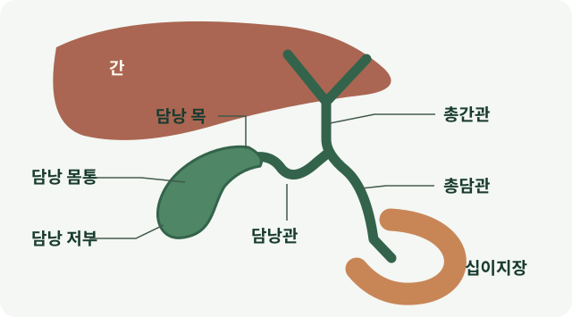

# 소화·비위 한의학 허브 {#_1}

소화기 증상은 **식후 악화 여부, 식욕과 식사량, 조기포만, 트림·신물, 복통·팽만, 오심, 배변 변화, 스트레스와의 연동**을 함께 살펴야 합니다.

## 간·담낭·췌장·위·소장·대장은 어떻게 연결되나요? {#digestive-organ-map}

음식은 위에서 섞이고 소장으로 이동해 소화·흡수됩니다. 간에서 만든 담즙과 췌장의 소화액이 소장으로 들어와 이 과정을 돕고, 대장은 수분을 흡수해 변을 만들고 배출합니다. 같은 ‘소화가 안 된다’는 말도 **섭취·위의 식후불편·담즙과 소화효소·흡수·배변 중 어느 문제가 중심인지** 나누어 봅니다.

| 기관 | 소화에서 맡는 역할 | 관련 불편과 다음 안내 |
|---|---|---|
| 간 | 담즙을 만들고 흡수한 영양소를 처리·저장 | [지방간](../conditions/fatty-liver.md) · [간수치 상승](../conditions/elevated-liver-enzymes.md); 소화불편만으로 간질환을 판단하지 않음 |
| 담낭·담도 | 담즙을 저장·농축하고 식사 때 소장으로 보냄 | 오른쪽 윗배 통증·황달·발열은 [담낭·담도 평가](#gallbladder-findings)로 연결 |
| 췌장 | 탄수화물·단백질·지방을 분해하는 효소를 소장에 공급 | 등으로 뻗는 상복부 통증, 지방변·체중감소는 [췌장·소화효소 평가](#pancreatic-care) |
| 위 | 음식을 받아 섞고 위산·효소와 함께 소화한 뒤 소장으로 배출 | [식후불편·조기포만](../conditions/functional-dyspepsia.md) · [위염·속쓰림](../conditions/gastritis-symptoms.md) |
| 소장 | 십이지장·공장·회장으로 이어지며 소화와 영양소 흡수의 중심 | 지속 설사·체중저하·흡수 문제는 [설사 원인 평가](../conditions/diarrhea.md)와 영양 상태를 함께 확인 |
| 대장·직장 | 수분을 흡수하고 변을 이동·저장해 배출 | [변비](../conditions/constipation.md) · [설사](../conditions/diarrhea.md) · [IBS](../conditions/ibs.md); 혈변·지속 변화는 별도 평가 |

[NIDDK 소화기관의 역할](https://www.niddk.nih.gov/health-information/digestive-diseases/digestive-system-how-it-works). 한의학의 ‘비위’는 음식 섭취와 운화·회복을 묶어 설명하는 기능 개념입니다. 해부학적 비장·췌장·위 한 기관과 동일시하지 않으며, ‘간울·간담습열’도 간수치·담석이라는 진단명과 구분합니다.

## 증상으로 찾기 {#_2}

| 불편함 | 대표 문서 |
|---|---|
| 먹고 나면 더부룩하고 명치가 답답함 | [소화불량](../conditions/dyspepsia.md) · [기능성소화불량](../conditions/functional-dyspepsia.md) |
| 오른쪽 윗배 통증 또는 초음파에서 담낭 이상 소견 | [담낭용종·슬러지·담석·담낭염](#gallbladder-findings) · [담도성 통증과 검사](#biliary-pain-assessment) |
| 배가 아프거나 반복적으로 불편함 | [복통](../conditions/abdominal-pain.md) |
| 배에 가스가 차고 빵빵함 | [복부팽만](../conditions/bloating.md) · [장내가스](../conditions/abdominal-gas.md) |
| 조금만 먹어도 배부름 | [조기포만 안내](../answer-guides/early-satiety-guide.md) · [성인 식욕저하](../conditions/poor-appetite-adult.md) |
| 변비와 배변곤란 | [변비](../conditions/constipation.md) |
| 배변 때 피가 보이거나 검은 변 | [혈변·항문출혈](../conditions/rectal-bleeding.md) |
| 항문 통증·덩이·돌출 | [치질·치핵](../conditions/hemorrhoids.md) · [탈항·직장탈출](../conditions/rectal-prolapse.md) |
| 묽은 변과 잦은 설사 | [설사](../conditions/diarrhea.md) · [아침·식후설사](../conditions/morning-diarrhea.md) |
| 복통과 배변 변화가 반복됨 | [과민성장증후군](../conditions/ibs.md) |
| 속쓰림·명치통증이 있음 | [위염·속쓰림](../conditions/gastritis-symptoms.md) |
| 신물·가슴쓰림과 식후·누운 자세에서 악화 | [역류성식도염](../conditions/gerd.md) · [치료 뒤 지속 증상 평가](../conditions/gerd.md#reflux-testing) |
| 트림이 반복되거나 음식물이 되올라옴 | [위내·위상부 트림 감별](../conditions/belching.md#belching-baseline) |
| 검진에서 지방간·간수치 이상을 들음 | [지방간의 네 평가축](../conditions/fatty-liver.md#three-axes) · [간수치 추세](../conditions/elevated-liver-enzymes.md) |
| 메스꺼움·먹기 불편함 | [오심](../conditions/nausea.md) · [소아 식욕부진](../conditions/child-poor-appetite.md) |

### 같은 상복부 불편도 평가 경로가 다릅니다 {#digestive-assessment}

| 중심 문제 | 질환·검사에서 구분할 내용 | 치료 목표와 다음 경로 |
|---|---|---|
| 위의 식후불편·명치통증 | 식후불편형과 명치통증형, 역류·궤양·헬리코박터와 복용약 | 편하게 먹는 양·오심·불편시간; [기능성소화불량](../conditions/functional-dyspepsia.md) |
| 소장의 소화·흡수 문제 | 지속 설사·지방변·영양저하에서 약물·감염·염증·췌장 소화효소 등 원인 | 영양·체중·변 상태; [설사](../conditions/diarrhea.md) · [식욕저하](../conditions/poor-appetite-adult.md) |
| 대장의 배변·복통 문제 | 변비의 건조변과 배출곤란, 설사의 절박감·야간 증상, IBS와 다른 질환 | 변 형태·힘주기·복통·생활 방해; [변비](../conditions/constipation.md) · [IBS](../conditions/ibs.md) |

식후 그득함·조기포만, 명치통증·작열감은 기능성소화불량의 증상 유형으로 구분합니다. 신물·가슴쓰림은 역류를, 복통과 변 형태·횟수 변화는 배변 관련 질환을 함께 봅니다. 서로 겹칠 수 있으므로 가장 식사와 생활을 방해하는 증상을 따로 기록합니다.

내시경이 정상이어도 병력·복용약·헬리코박터 검사 여부와 필요한 감별을 함께 확인합니다. 검사는 모든 사람에게 같은 묶음으로 시행하지 않고 증상·위험요인·기존 결과에 맞춰 정합니다. 헬리코박터 검사 때는 위산억제제 등 복용약이 결과에 영향을 줄 수 있어 검사팀의 안내를 확인합니다. [NIDDK 소화불량 진단](https://www.niddk.nih.gov/health-information/digestive-diseases/indigestion-dyspepsia/diagnosis) · [NICE 소화불량·헬리코박터 평가](https://www.nice.org.uk/guidance/cg184/chapter/Recommendations)

### 탄산·조잡·애기는 불편의 내용을 나누는 말입니다 {#acid-belching-care}

[《의학입문》의 소화기 문목](../classics/uihak-ipmun.md#digestive-terms)은 신물이 넘어오는 탄산·토산, 허기·통증과 비슷한 속의 불편인 조잡, 트림인 애기를 나눕니다. 오늘은 신물·공기·음식물 되올라옴, 공복·식후 불편과 실제 섭취량을 각각 확인합니다. 이 용어를 하나의 역류 진단으로 합치지 않습니다.

[좌금환](../formulas/zuojin-wan.md)은 황련·오수유의 청열·강역을, [선복대자탕](../formulas/xuanfu-daizhe-tang.md)은 선복화·대자와 인삼·생강 등의 강역·보중을 비교합니다. 식적의 보화환, 한열착잡·심하비의 반하사심탕과 같은 목적의 처방으로 묶지 않고 [소화 처방 비교표](../herbal-integrated/formula-for-digestion.md#digestive-pattern-comparison)에서 냉열·허실·담·식적의 차이를 이어 봅니다.

### 배변 뒤 출혈·통증·돌출은 별도로 구분합니다 {#anorectal-care}

혈변은 [출혈의 양상·전신 상태·검사 선택](../conditions/rectal-bleeding.md#assessment)을 확인하고, 치핵은 [내치핵·외치핵·치열 등 감별](../conditions/hemorrhoids.md#differential)에서 시작합니다. 조직이 밖으로 나오면 치핵 탈출과 직장탈출을 구분하고 배출·점액·누출을 함께 평가합니다.

[괴화산](../formulas/huaihua-san.md)의 청장·량혈·소풍·행기, [지유](../herbs/sanguisorba-root.md)의 량혈지혈·렴창, [보중익기탕](../formulas/buzhong-yiqi-tang.md)의 보기승양은 서로 다른 전통 치료 방향입니다. 출혈·탈출이라는 이름만으로 처방을 고정하지 않고 원인 평가와 [배변·구조적 치료](../conditions/rectal-prolapse.md#treatment)의 목표를 맞춥니다.

## 주요 변증 {#_3}

| 동반 양상 | 병증·대표 처방군 | 확인할 질문·심화 경로 |
|---|---|---|
| 식욕저하·식후피로·무른 변 | 비위기허; [육군자탕](../formulas/liujunzi-tang.md)·[향사육군자탕](../formulas/xiangsha-liujunzi-tang.md) | 평소 소화력이 약한가, 식사량·체중이 변했는가; [기능성소화불량](../conditions/functional-dyspepsia.md) |
| 오심·팽만·무거움 | 담음·습체; [평위산](../formulas/pingwei-san.md)·육군자탕 계열 | 과식보다 담습·습체의 양상이 지속되는가; [담음·식적 감별](../diagnostics/differentials/phlegm-vs-food-stagnation.md) |
| 과식 뒤 신트림·복창 | 식적; [보화환](../formulas/baohe-wan.md) | 음식 정체의 시작과 회복이 뚜렷한가; [소화불량](../conditions/dyspepsia.md) |
| 긴장 뒤 복통·팽만·배변 변화 | 간위불화·간비불화; [시호소간산](../formulas/chaihu-shugan-san.md) 등 | 상복부 불편인가, 배변 관련 복통인가; [스트레스·소화](../autonomic/stress-digestion.md) · [IBS](../conditions/ibs.md) |
| 명치 그득함·오심·장명·설사 | 한열착잡; [반하사심탕](../formulas/banxia-xiexin-tang.md) | 냉열·허실이 어떻게 겹치는가; [위염·속쓰림](../conditions/gastritis-symptoms.md#herbal-treatment) |
| 냉감·식욕저하에 팽만·기체 | 비위허한·습체; [향사양위탕](../formulas/xiangsha-yangwei-tang.md) | 냉감뿐 아니라 섭취량·변 상태·허약이 함께 있는가; [소화 처방 비교](../herbal-integrated/formula-for-digestion.md#digestive-pattern-comparison) |
| 오래된 묽은변·식욕저하·피로 | 비위기허·수습; [삼령백출산](../formulas/shenling-baizhu-san.md) | 야간설사·혈변·체중감소나 약물 변화는 없는가; [만성설사](../conditions/diarrhea.md) |
| 단단한 변·힘주기·잔변감 | 장조·열결 등; [마자인환](../formulas/mazi-ren-wan.md) | 변의 굳기와 배출곤란 중 무엇이 중심인가; [변비](../conditions/constipation.md) |

증상 유형과 변증은 일대일로 고정하지 않습니다. 식욕저하·식후 처짐의 고전 맥락은 [《비위론》](../classics/piwei-lun.md#intake-and-function)에서, 처방 선택은 실제 증후와 복용약을 확인해 연결합니다.

담적이라는 설명을 들었다면 [담적 전체 안내](../diagnostics/phlegm-accumulation.md)와 [담음의 처방 구조](../diagnostics/phlegm-fluid.md)에서 의미를 확인합니다. 지속 소화불편을 한 용어로 묶기보다 음식·오심·냉열·식사량·배변에 따라 위 비교표의 병증을 구분합니다.

## 본초·방제·경혈 {#_4}

본초는 성미·전통 효능과 **처방 안에서 맡는 역할**을 함께 읽습니다. 보하는 약과 팽만·오심을 조절하는 약을 함께 쓰는 이유, 같은 약재가 다른 배합에서 달리 활용되는 이유를 비교합니다.

| 치료 방향 | 대표 본초 | 배합에서 보는 역할 |
|---|---|---|
| 보기·건비 | [인삼](../herbs/ginseng.md)·[백출](../herbs/atractylodes.md)·[복령](../herbs/poria.md)·[황기](../herbs/astragalus.md) | 식욕·기력·회복 기반; 사군자탕·육군자탕·보중익기탕의 차이를 확인 |
| 화담·강역 | [반하](../herbs/pinellia.md)·[진피](../herbs/citrus-peel.md) | 담습·오심·상역을 함께 다룸; 육군자탕은 보기 골격도 포함 |
| 행기·제만·화습 | [후박](../herbs/magnolia-bark.md)·[사인](../herbs/amomum.md)·[목향](../herbs/aucklandia.md) | 팽만·기체의 비중을 조절하고 보익약의 소화 부담도 함께 살핌 |
| 소식·화적 | [산사](../herbs/hawthorn.md)·[맥아](../herbs/barley-malt.md) | 음식 정체를 다루는 전통 배합; 실제 효소 활성·효소식품과 구분 |
| 건비·삼습·지사 | [산약](../herbs/dioscorea.md)·[의이인](../herbs/coix.md)·[연자육](../herbs/lotus-seed.md) | 만성 묽은변·섭취저하의 회복 기반과 수습을 함께 봄 |
| 윤장·통변 | [마자인](../herbs/cannabis-seed.md)·[대황](../herbs/rhubarb.md)·[지실](../herbs/citrus-immature.md) | 건조변의 윤장과 적체의 통하·제만을 구분하고 배출 기능을 확인 |

[소화·간담·배변 본초 비교](../herbal-integrated/herbs-for-digestion.md) · [소화 한약 처방 찾기](../herbal-integrated/formula-for-digestion.md). 위 표는 단독 복용 목록이 아니라 배합 이해를 돕는 자료입니다. 긴장과 복통·설사가 함께 변하는 간비불화의 처방 비교는 [통사요방 근거](../authority/formulas/tongxie-yaofang.md)와 [IBS 한약 지도](../authority/formulas/ibs-herbal-formula-map.md)로 이어집니다.

[보중익기탕](../formulas/buzhong-yiqi-tang.md#fatigue-with-digestion)은 식욕·기력이 약해지면서 승거 기능의 저하가 함께 있는지 살피는 경로입니다. 더부룩함·오심이 중심인 육군자탕 계열과의 차이는 [비위론의 식후 증상·처방 비교](../classics/piwei-lun.md#postmeal-patterns)에서 확인할 수 있습니다.

### 간·담낭 질환과 본초·방제를 연결할 때 {#hepatobiliary-care}

‘간에 좋은 한약’은 **지방간·간수치 상승·바이러스간염·담도 문제 중 무엇을 평가하는지**부터 구분합니다. 지방간에서는 지방축적, 간세포 손상, 섬유화 위험, 혈당·지질·체중을 함께 봅니다. 피로와 소화가 좋아지는 변화, 간수치 변화와 섬유화 위험 변화도 각각 기록합니다. [지방간의 평가·치료](../conditions/fatty-liver.md) · [간수치 상승](../conditions/elevated-liver-enzymes.md)

| 함께 살필 병증·목표 | 연결 본초 | 비교할 한약·방제와 구분점 |
|---|---|---|
| 긴장·흉협 답답함과 소화·수면 변동 | [시호](../herbs/bupleurum.md)·[백작약](../herbs/white-peony.md)·[당귀](../herbs/angelica.md) | [시호소간산](../formulas/chaihu-shugan-san.md)·[소요산](../formulas/xiaoyao-san.md); 기체와 혈허·비허의 동반을 구분 |
| 습열·열감과 황달 관련 전통 배합 | [인진](../herbs/artemisia-capillaris.md)·[치자](../herbs/gardenia.md)·[대황](../herbs/rhubarb.md) | [인진호탕의 퇴황 배합](../formulas/injin-ho-tang.md#formula-composition); 황달의 원인·담도 상태를 먼저 평가 |
| 간담실화·습열의 전통 병증 | [용담](../herbs/gentian-root.md)·황금·치자·[택사](../herbs/alisma.md) | [용담사간탕](../formulas/longdan-xiegan-tang.md); ‘간담’ 병위와 간수치·담석 적응증을 구분 |
| 담습·식후팽만·식욕저하가 동반 | 반하·진피·복령·백출 | [이진탕](../formulas/erchen-tang.md)·평위산·육군자탕; 소화·수분정체·허약의 비중에 맞춰 비교 |
| 소양병의 흉협고만·식욕저하·구역 | 시호·황금·반하·인삼 | [소시호탕](../formulas/xiaochaihu-tang.md); 고전 증후와 연구 제제·대상을 확인하고 현재 간염 치료와 조율 |

처방 전에는 기존 간질환, 음주, 처방약·한약·보충제의 구성과 시작 시점, 검사 추세를 공유합니다. [한약 간 안전성 자료](../herbal-integrated/safety.md#liver-safety-evidence)와 [간 영양제·한약 병용](../conditions/liver-supplements-herbal.md)에서 제형·병용 조건을 확인할 수 있습니다.

#### 담낭용종·슬러지·담석·담낭염은 어떻게 다른가요? {#gallbladder-findings}

담낭(쓸개)은 오른쪽 윗배의 간 아래에 있습니다. 간에서 만든 담즙을 저장·농축했다가 식사 뒤 내보냅니다. 담낭의 둥근 끝은 **저부**, 관으로 좁아지는 쪽은 **목**입니다. 담낭관이 간에서 내려오는 총간관과 만나 총담관이 되고, 담즙은 이 길을 따라 십이지장으로 들어갑니다. 돌이 어느 곳을 막는지에 따라 나타나는 문제가 달라집니다. [NHS 담낭과 담도 해부](https://www.nhs.uk/tests-and-treatments/gallbladder-removal/what-is-gallbladder-removal/)

| 소견 | 초음파·증상에서 볼 단서 | 다음에 확인할 것 |
|---|---|---|
| **담낭용종** | 담낭 벽에서 안쪽으로 돌출합니다. 대개 자세를 바꿔도 자리에 남으며 뒤쪽 음향 그림자가 없습니다. 콜레스테롤 용종 같은 양성 병변이 흔하고 검진에서 우연히 발견되는 경우가 많습니다. | 최대 크기·위치·모양, 인접 벽 비후와 이전 영상에서의 변화를 비교합니다. |
| **담낭 슬러지** | 담즙 속 입자가 가라앉은 상태입니다. 흔히 중력 방향으로 층을 이루고 체위 변화에 천천히 움직이며 음향 그림자는 없습니다. 뭉친 슬러지는 용종처럼 보일 수 있습니다. | 시간이 지나며 사라지거나 지속될 수 있고 일부는 담석으로 진행합니다. 통증·염증·췌장염 동반 여부에 따라 평가합니다. |
| **담석** | 전형적으로 밝은 돌 뒤에 음향 그림자가 생기고 체위에 따라 움직입니다. 목에 걸린 돌은 움직이지 않을 수 있습니다. | 우연히 발견된 무증상 담석과 담도성 통증을 반복하는 담석의 치료 판단은 다릅니다. |
| **급성 담낭염** | 대개 담낭관 폐쇄 뒤 생기는 염증입니다. 오른쪽 윗배의 지속통·압통과 발열, 초음파의 벽 비후·주변 액체 등이 단서입니다. | 증상·진찰·혈액검사·영상을 종합해 신속히 평가합니다. |
| **총담관결석·담관염** | 총담관이 막히면 황달·짙은 소변·옅은 변이 생길 수 있습니다. 감염이 겹치면 발열·오한이 나타날 수 있고, 결석은 췌장염도 일으킬 수 있습니다. | 담관 확장과 빌리루빈·간담도 수치를 확인합니다. 담관염이 의심되면 응급 평가가 필요합니다. |

[대한복부영상의학회 2025 담낭용종 권고](https://doi.org/10.3348/kjr.2024.0914) · [슬러지·미세담석 국제 합의](https://pmc.ncbi.nlm.nih.gov/articles/PMC10511955/) · [슬러지의 자연 경과](https://pmc.ncbi.nlm.nih.gov/articles/PMC8341470/) · [WSES 급성 담낭염 지침](https://pubmed.ncbi.nlm.nih.gov/33153472/)

#### 담낭용종은 몇 mm부터 추적하나요? {#gallbladder-polyp-followup}

[담낭용종 전용 안내](../conditions/gallbladder-polyp.md)에서 검진 결과를 확인할 때 자주 묻는 질문과 다음 진료 준비를 살펴볼 수 있습니다.

대한복부영상의학회 2025 권고에서 **우연히 발견된 6 mm 미만 용종**은 우려 소견이 없으면 추적을 권하지 않습니다. **6–9 mm**는 나이와 모양에 맞춰 추적합니다. 우려 소견이 없는 50세 미만은 연 1회씩 5년, 우려 소견이 있는 50세 미만이나 우려 소견이 없는 50세 이상은 첫해 6개월 간격, 이후 4년간 연 1회입니다. 50세 이상에서 우려 소견이 있으면 추적과 수술을 함께 검토합니다. 5년간 안정적이면 추적 종료를 고려할 수 있습니다. 우려 소견은 넓은 바닥으로 붙는 모양, 인접 담낭벽 비후, 뚜렷한 성장입니다. **10–14 mm**는 이런 소견과 수술 가능 여부를 함께 판단하고, **15 mm 이상**은 수술 가능한 환자에서 담낭절제술을 권고합니다. 원발성 경화성 담관염이나 담낭암이 의심되는 소견은 별도로 평가합니다. [대한복부영상의학회 권고 KQ 12·16·17](https://doi.org/10.3348/kjr.2024.0914)

초음파에서 1–2 mm 차이가 보이면 이전 영상과 같은 위치의 병변인지, 가장 긴 지름을 잰 단면이 맞는지 함께 확인합니다. 여러 개라면 가장 큰 병변의 위치와 모양을 비교합니다. 뚜렷하게 커졌거나 추적 방침이 달라지는 크기 구간에 들어섰다면 작은 차이라도 이전 영상을 대조해 판단합니다. [크기 측정과 성장 판단 KQ 1·4](https://doi.org/10.3348/kjr.2024.0914)

#### 오른쪽 윗배 통증은 무엇부터 확인하나요? {#biliary-pain-assessment}

전형적인 담도성 통증은 오른쪽 윗배나 명치에서 시작해 수십 분에서 수시간 이어지고, 일상을 중단할 만큼 아프거나 등·오른쪽 견갑골 아래로 퍼질 수 있습니다. 수초간 스치는 뻐근함, 누르거나 몸을 돌릴 때 재현되는 통증, 배변 뒤 달라지는 통증은 각각 [늑골·복벽과 옆구리](../conditions/flank-pain.md), 위장관 등 다른 원인도 함께 살핍니다. 초음파에서 우연히 보인 용종은 통증의 지속시간·동반 증상과 따로 판단합니다. [Rome V 담도성 통증 기준](https://theromefoundation.org/rome-v-criteria/) · [NIDDK 담석 증상](https://www.niddk.nih.gov/health-information/digestive-diseases/gallstones/symptoms-causes)

**수시간 가는 심한 윗배 통증, 발열·오한, 황달, 반복 구토**가 있으면 바로 진료받습니다. 담석이 의심되면 복부 초음파와 간담도 혈액검사를 먼저 시행합니다. 초음파에서 총담관결석이 보이지 않아도 담관이 넓거나 관련 혈액검사가 비정상이면 자기공명담췌관조영술(MRCP) 등을 고려합니다. [NICE 담석 평가·치료](https://www.ncbi.nlm.nih.gov/books/NBK327519/)

무증상 담석은 대개 관찰하고, 증상을 일으키는 담낭결석은 복강경 담낭절제술을 논의합니다. 총담관결석은 내시경 등으로 제거할 수 있습니다. 우르소데옥시콜산(UDCA)으로 돌을 녹이는 치료는 수술이 어렵고 작은 콜레스테롤 담석이 있는 경우 등 제한된 조건에서 검토합니다. 담낭용종의 관리 기준은 위의 크기·모양·추적 영상입니다. 식후 통증을 되풀이해서 유발하는 음식이 있다면 종류와 양을 기록하고, 진료까지 그 음식을 조절합니다. [NICE 담석 치료](https://www.ncbi.nlm.nih.gov/books/NBK327519/) · [NIDDK 담석의 비수술 치료](https://www.niddk.nih.gov/health-information/digestive-diseases/gallstones/treatment/)

#### 담낭·담도 평가 뒤 한의치료의 목표 {#biliary-korean-medicine}

원인 평가 뒤 상태가 안정적이라면 **흉협부 불편, 오심, 식후팽만, 식사량과 변 상태** 중 일상에 가장 지장을 주는 증상을 정합니다. 옆구리가 그득하고 긴장에 따라 달라지는 경우와, 한열왕래·구역이 겹치거나 명치가 당기고 복부 긴장이 뚜렷한 경우는 변증과 처방이 달라집니다. [간·담 병증의 다섯 처방 비교](../zangfu-pattern-network/liver-gallbladder.md#biliary-pattern-formulas)

침치료를 병행할 때는 전통적으로 협륵부 불편에 [양릉천 GB34](../acupuncture/points/gb34-yanglingquan.md), 오심에 [내관 PC6](../acupuncture/points/pc6-neiguan.md), 식후 불편에 [족삼리 ST36](../acupuncture/points/st36-zusanli.md) 등을 증상과 진찰에 맞춰 검토합니다. 전침·약침을 고려할 때는 시술 부위·제제와 수술력·복용약을 확인합니다. 치료 경과는 통증의 강도·지속시간, 오심, 식사량과 배변으로 기록하고, 담낭 병변의 경과는 계획한 영상 검사로 확인합니다.

- **침과 담도성 산통:** 전향적 관찰연구 59명에서 양릉천·족삼리 수기침을 받은 29명의 통증이 30분 안에 감소했습니다. 무작위 배정 없이 약물치료군과 비교했고 단기 통증을 측정했으므로 표준 진통치료와의 우열, 결석 제거 또는 재발 예방을 판단하기에는 제한이 있습니다. [PMID 42910540](https://pubmed.ncbi.nlm.nih.gov/42910540/)
- **한약과 담석:** Cochrane 검토는 무증상 또는 경증·중등도 담석증 임상시험 11건(1,205명)을 검토했습니다. 위약 대조시험이 없었고 증상·결석 변화의 보고가 충분하지 않아, 검토한 제제의 이득을 확정하기 어려웠습니다. [Cochrane CD004547](https://www.cochrane.org/evidence/CD004547_chinese-medicinal-herbs-cholelithiasis)

담낭을 절제한 뒤의 식사량·묽은 변·오심 관리는 [담낭절제 후 회복](../conditions/postoperative-recovery.md#gallbladder-recovery)에서 이어집니다.

### 췌장·소장과 소화효소·흡수를 살피는 경우 {#pancreatic-care}

췌장염에서는 상복부 통증이 등으로 뻗거나 구토·발열이 동반될 수 있습니다. 지속되는 심한 통증은 일반 체기와 구분해 평가합니다. 지방변·체중감소·섭취저하가 이어지면 췌장 외분비 기능과 소장 흡수, 영양 상태를 함께 확인합니다. [NIDDK 췌장염 안내](https://www.niddk.nih.gov/health-information/digestive-diseases/pancreatitis/symptoms-causes)

췌장 외분비부전이 확인된 경우에는 처방 췌장효소와 영양 관리가 치료에 포함됩니다. 곡물효소 식품과 처방 췌장효소는 성분·용량·적응증이 달라 같은 치료로 바꾸지 않습니다. [NIDDK 췌장 외분비부전 치료](https://www.niddk.nih.gov/health-information/digestive-diseases/exocrine-pancreatic-insufficiency/treatment) · [곡물효소의 작용](../conditions/grain-fermented-enzymes.md#digestive-roles)

검사는 급성 통증과 흡수장애의 질문에 맞춰 다르게 정합니다. 췌장염이 의심되면 췌장효소 혈액검사·영상 등으로 원인을 평가하고, 소화·흡수 저하에서는 대변·영양 평가가 필요할 수 있습니다. 개인별 검사 선택은 담당 의료진과 확인합니다. [NIDDK 췌장염 검사](https://www.niddk.nih.gov/health-information/digestive-diseases/pancreatitis/diagnosis)

원인질환 치료와 함께 안정기에 남는 식욕·오심·묽은변·피로를 평가해 건비·화담·삼습 등 한약의 목표를 정할 수 있습니다. 예를 들어 육군자탕과 삼령백출산은 각각 상복부 불편과 만성 묽은변의 동반 양상을 비교하는 경로이며, 이들 처방을 췌장 재생·담석 제거·모든 흡수장애 치료로 설명하지 않습니다.

## 치료와 근거 연결 {#_5}

| 치료·관리 | 구체적인 목표 | 이어서 볼 자료 |
|---|---|---|
| 한약·방제 | 식사량·식후불편·오심·냉열·변 상태와 동반 허약에 맞춘 배합 | [소화 한약](../herbal-integrated/formula-for-digestion.md) · [한약 연구 해설](../authority/formulas/digestive-herbal-evidence.md#patient-study-summary) |
| 침·전침·약침 | 상복부 불편·오심·배변 등 목표와 자극 방법·제제·시술 부위를 구체화 | [소화기 경혈](../acupuncture-integrated/points-for-digestion.md) · [소화불량 경혈 지식망](../network/dyspepsia-acupoints.md) |
| 식사·수면·긴장 관리 | 실제 유발 요인, 충분한 섭취와 수면, 긴장과 증상의 관계를 조정 | [스트레스·소화](../autonomic/stress-digestion.md) · [기능성소화불량 경과](../conditions/functional-dyspepsia.md#outcomes) |
| 곡물효소·영양 지원 | 제품의 실제 성분·활성과 섭취 목표, 원인질환의 치료를 구분 | [곡물효소는 어떤 성분의 분해를 돕나요?](../conditions/grain-fermented-enzymes.md#digestive-roles) |

중완 CV12·족삼리 ST36·내관 PC6·공손 SP4·천추 ST25·상거허 ST37 등은 상복부·오심·배변의 비중에 맞춰 배합합니다. 경혈 이름만으로 자가 자침을 정하지 않고 실제 진찰과 복부 수술력·임신 가능성·해부학적 안전성을 함께 봅니다.

### 위와 대장 연구는 평가한 증상별로 읽습니다 {#digestive-evidence-routes}

| 임상 질문 | 대표 근거 | 읽을 결과 |
|---|---|---|
| 식후 그득함·조기포만에 침이나 한약이 도움이 되나요? | [기능성소화불량의 직접 비교시험](../conditions/functional-dyspepsia.md#pds-acupuncture-results) · [육군자탕 연구](../research/formulas/rikkunshito.md) | 식후 증상·전체 호전·삶의 질과 연구 제제를 구분 |
| 복통과 배변 변화가 반복될 때 어떤 근거가 있나요? | [IBS 침 근거](../authority/conditions/irritable-bowel-syndrome.md) · [IBS 한약 지도](../authority/formulas/ibs-herbal-formula-map.md) | 설사형·변비형·혼합형, 복통·변 상태와 비교군 |
| 건조변·배변곤란에서 한약을 어떻게 평가했나요? | [마자인환의 임상시험](../formulas/mazi-ren-wan.md) · [변비 한약 지도](../authority/formulas/functional-constipation-herbal-map.md) | 완전자발배변·변 형태·힘주기·구제약과 추적기간 |
| 장 점막·미생물·면역의 변화는 무엇을 뜻하나요? | [소화·장 점막·면역](../immune-allergy/gut-recovery.md#gut-mucosal-immunity) | 기전·검사 변화와 실제 증상·섭취 회복을 구분 |

연구 대상·처방 구성·용량·기간·비교군을 함께 읽습니다. 위장관 증상 연구의 결과를 간 섬유화·담석·췌장 기능 개선의 근거로 옮기지 않습니다. [소화불량 임상 지식망](../conditions/dyspepsia.md) · [현대 임상근거 허브](clinical-evidence.md)

## 식사와 배변을 같은 기준으로 기록합니다 {#digestive-followup}

| 관찰축 | 기록할 변화 |
|---|---|
| 섭취 | 평소 먹던 양 대비 현재 양, 식사를 멈추는 이유, 체중 추세 |
| 상복부 | 식후 불편 지속시간, 조기포만, 명치통증·작열, 트림·오심 |
| 배변 | 횟수·굳기·절박감·힘주기·잔변감, 야간설사·출혈 여부 |
| 일상 | 수면, 식후 활동·업무, 긴장과 증상의 관계 |
| 치료·검사 | 약·한약·효소·영양제 변경 시점, 간담·췌장 등 해당 질환의 추적 결과 |

식사 시간·양과 반복 유발 음식을 먼저 조정하고, 무조건적인 금식·음식 제한으로 섭취와 체중이 떨어지지 않도록 합니다. 유발 음식은 사람마다 다를 수 있습니다. [NIDDK 소화불량 식사 안내](https://www.niddk.nih.gov/health-information/digestive-diseases/indigestion-dyspepsia/eating-diet-nutrition)

IBS에서 저포드맵 등 제한 식이가 필요하면 식이 관리 경험이 있는 전문가와 영양 충족을 함께 계획합니다. [NICE IBS 식이 관리](https://www.nice.org.uk/guidance/qs114/chapter/quality-statement-3-dietary-management). 편하게 먹는 양은 늘었지만 설사·체중저하가 남는지, 팽만은 줄었지만 식욕·피로가 남는지 나누어 치료를 유지·조정합니다. [식욕과 회복 관리](tonic-recovery.md#daily-recovery-plan)

토혈·흑변·혈변, 진행하는 연하곤란, 반복 구토·탈수, 체중감소, 황달·발열과 심한 복통, 심한 팽만에 가스·대변이 나오지 않는 상태는 예정된 경과 관찰을 기다리지 않습니다. [소화기 증상에서 먼저 확인할 신호](../clinical-safety/digestive-red-flags.md)
